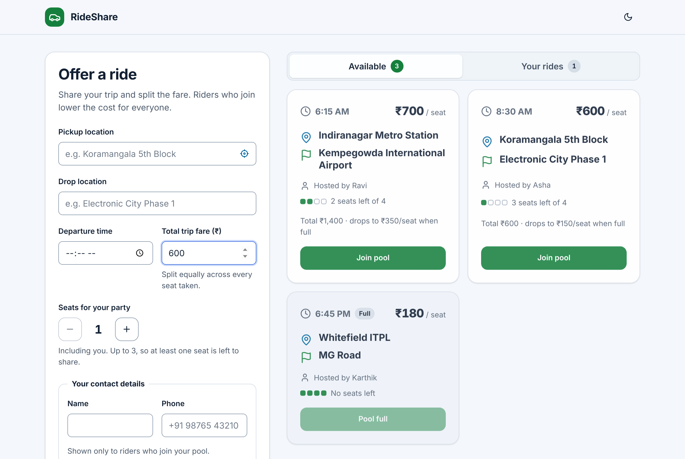
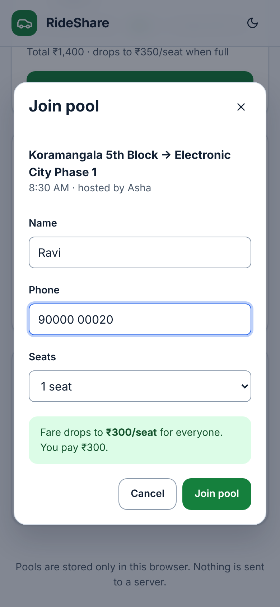
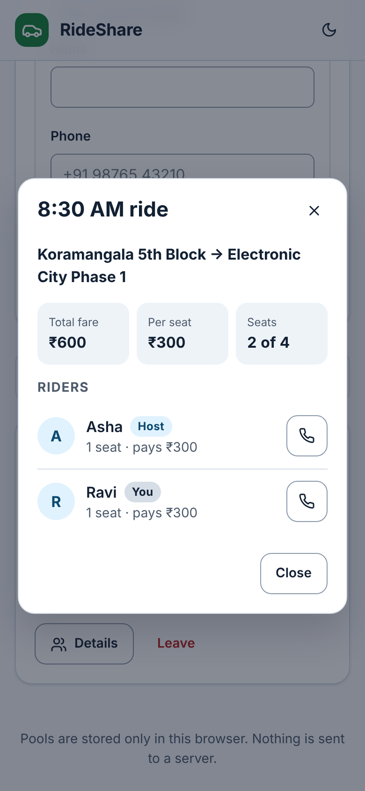
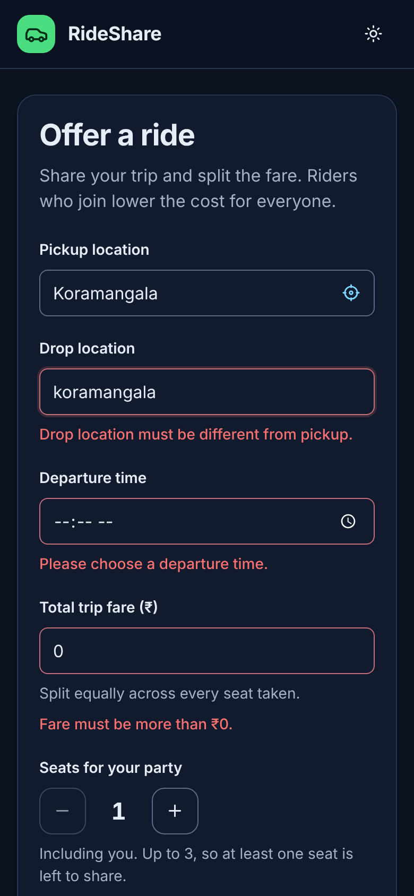
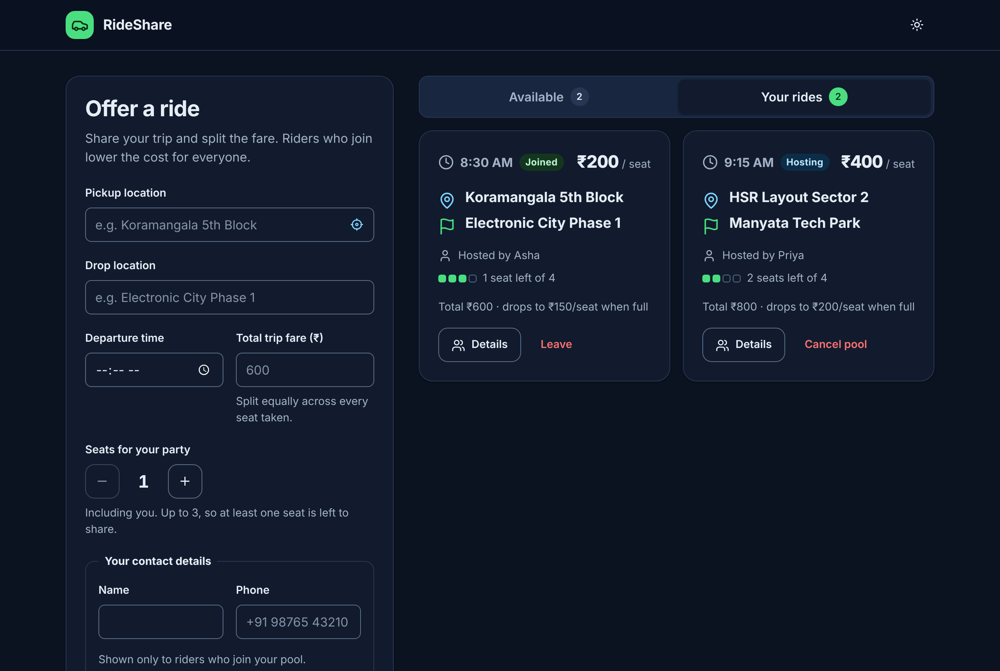
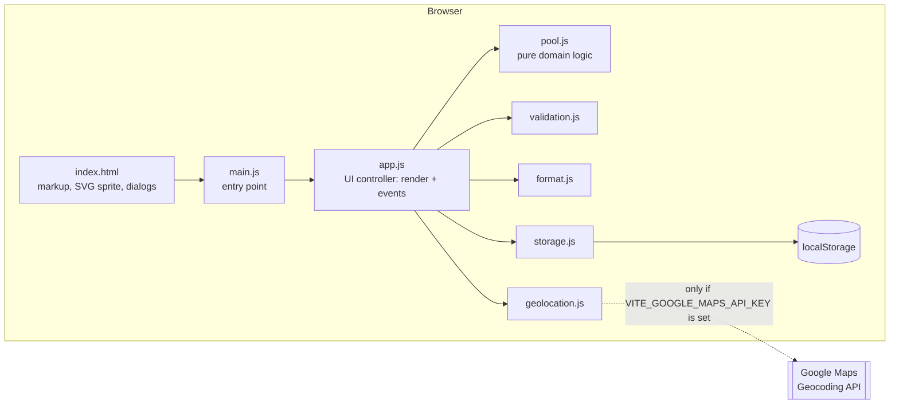

# RideShare

**Offer a seat on your trip, join someone else's, and split the fare fairly.**


RideShare is a small, dependency-free carpool web app. A host posts a trip with its pickup point, drop point, departure time and total fare. Other riders join, and the fare is split equally across every occupied seat, so each new rider lowers the cost for everyone.

It's for commuters, colleagues and friends who already share rides and want a quick way to see who's going where, how many seats are left and what each person owes, without a sign-up or a backend. Everything runs in the browser and is saved to `localStorage`.



<table>
  <tr>
    <td></td>
    <td></td>
    <td></td>
  </tr>
  <tr>
    <td align="center">Joining a pool</td>
    <td align="center">Ride details</td>
    <td align="center">Inline validation (dark)</td>
  </tr>
</table>



---

## Contents

- [Features](#features)
- [Tech stack](#tech-stack)
- [Architecture](#architecture)
- [Project structure](#project-structure)
- [Getting started](#getting-started)
- [Configuration](#configuration)
- [Usage](#usage)
- [Scripts](#scripts)
- [How the fare is split](#how-the-fare-is-split)
- [Testing](#testing)
- [Linting and formatting](#linting-and-formatting)
- [Deployment](#deployment)
- [Troubleshooting](#troubleshooting)
- [Known limitations](#known-limitations)
- [Roadmap ideas](#roadmap-ideas)
- [Contributing](#contributing)
- [License](#license)

## Features

- **Offer a ride.** Post the pickup, drop, departure time and total fare, and reserve 1–3 seats for your own party.
- **Use my location.** Fills the pickup field from the browser's Geolocation API. With a Google Maps key it shows a street address; without one it shows coordinates.
- **Join a pool.** Pick how many seats you need and see what the fare per seat drops to before you confirm.
- **Fair fare splitting.** The total fare is divided equally across occupied seats and recalculated whenever someone joins or leaves.
- **Seat tracking.** Each card shows seats taken and seats left. Full pools can't be joined, and one phone number can't join the same pool twice.
- **Your rides.** A separate tab lists the pools you host or have joined, with the rider list, what each rider pays, and `tel:` call links.
- **Leave or cancel.** Riders can leave a pool and hosts can cancel one. Both ask for confirmation first.
- **Sample data.** One click loads three demo pools so you can try the join flow on a single device.
- **Saved on your device.** State lives in `localStorage` with schema checks, so it survives a refresh and corrupt data is ignored.
- **Accessible.** Semantic landmarks, labelled fields, inline errors linked with `aria-describedby`, `aria-invalid`, focus moved to the first invalid field, native `<dialog>` modals (Esc closes them and focus is handled for you), WAI-ARIA tabs with arrow-key support, a skip link, visible focus rings and colour pairs that meet WCAG AA.
- **Light and dark themes.** Follows the system setting, with a toggle that's remembered.
- **Responsive.** Single column on phones and two columns on desktop, with 44px touch targets. Checked at 375px, 768px and 1280px with no horizontal scrolling.
- **Small.** No runtime dependencies and inline SVG icons: about 8 kB of JS and 4 kB of CSS after gzip.

## Tech stack

| Layer     | Choice                                                                  | Why                                                      |
| --------- | ----------------------------------------------------------------------- | -------------------------------------------------------- |
| Markup    | HTML5, native `<dialog>`, inline SVG sprite                             | No UI framework needed for an app this size              |
| Styling   | Plain CSS with custom-property design tokens                            | One spacing, type and colour system, plus dark mode      |
| Logic     | Vanilla JavaScript (ES modules), JSDoc types                            | Keeps the original project's no-framework approach       |
| Build/dev | [Vite](https://vite.dev/)                                               | Fast dev server, hashed production assets, env variables |
| Tests     | [Vitest](https://vitest.dev/) + [jsdom](https://github.com/jsdom/jsdom) | Unit tests plus DOM tests that use the real `index.html` |
| Quality   | ESLint (flat config) + Prettier                                         | Consistent, lint-clean code                              |
| Optional  | Google Maps JavaScript API (Geocoding)                                  | Turns GPS coordinates into a street address              |

## Architecture

There's no server. The page loads `src/main.js`, which builds the controller in `src/app.js` and passes in its browser dependencies (`document`, `localStorage`, `navigator.geolocation` and the optional Maps key). Because they're passed in, the tests can run the same controller against jsdom with a fake storage and fake geolocation.



**Data flow.** Every user action goes through `commit(nextState)`. That function saves the state to `localStorage` and then re-renders both lists from scratch. All pool operations in `pool.js` are pure and return new objects, so nothing is mutated in place.

**State shape** (stored under the `rideshare:state` key):

```json
{
  "version": 1,
  "pools": [
    {
      "id": "sample-morning",
      "pickup": "Koramangala 5th Block",
      "drop": "Electronic City Phase 1",
      "time": "08:30",
      "fare": 600,
      "capacity": 4,
      "riders": [{ "name": "Asha", "phone": "+919000000001", "seats": 1, "role": "host" }],
      "createdAt": 1731600000000
    }
  ],
  "mine": { "sample-morning": "rider" },
  "myPhones": { "sample-morning": "+919000000020" }
}
```

`mine` records which pools this device hosts or has joined. That decides whether a pool appears under **Available** or **Your rides**. `myPhones` is used to mark "You" in the rider list and to remove the right rider when you leave.

**Security.** All user-supplied text reaches the DOM through `textContent` and text nodes via a small `h()` helper in `src/dom.js`. Nothing is parsed as HTML, and `tests/app.test.js` includes a regression test for this.

## Project structure

```text
rideshare/
├── index.html            # App shell: header, form, tabs, dialogs, SVG icon sprite, meta tags
├── 404.html              # Not-found page (served by static hosts for unknown paths)
├── public/
│   ├── favicon.svg
│   └── og-image.png      # Social preview image (a screenshot of the running app)
├── src/
│   ├── main.js           # Entry point: imports CSS, wires real browser APIs into the app
│   ├── app.js            # UI controller: rendering, events, dialogs, tabs, theme, toasts
│   ├── pool.js           # Pure pool logic: create/join/leave, seats, fare splitting
│   ├── validation.js     # Form validation and phone normalisation
│   ├── format.js         # Currency (INR), 12-hour time and phone formatting
│   ├── storage.js        # Versioned localStorage persistence with schema checks
│   ├── geolocation.js    # Geolocation and optional Google Maps reverse geocoding
│   ├── sample-data.js    # Demo pools (generic names, reserved +91 90000 0000x numbers)
│   ├── dom.js            # h() element factory and icon() helper (no innerHTML)
│   ├── not-found.js      # Loads shared styles for 404.html
│   └── styles.css        # Design tokens, light/dark themes, components
├── tests/                # Vitest suites (unit + jsdom integration)
├── docs/screenshots/     # README screenshots taken from the running app
├── .env.example          # Optional environment variables
├── eslint.config.js
├── vite.config.js        # Multi-page build (index + 404) and Vitest config
└── package.json
```

## Getting started

### Prerequisites

- **Node.js 20.19+** (or 22.12+), which Vite 8 requires
- npm 10+ (comes with Node)

### Installation

```bash
git clone https://github.com/jeevithg090/rideshare.git
cd rideshare
npm install
cp .env.example .env   # optional, only needed for street-address lookup
npm run dev
```

Open the URL Vite prints (normally <http://localhost:5173>).

### Production build

```bash
npm run build     # outputs static files to dist/
npm run preview   # serves dist/ at http://localhost:4173
```

## Configuration

All configuration is optional. Variables are read at **build time** by Vite, and only variables prefixed with `VITE_` are exposed to the client.

| Variable                   | Required | Default | Description                                                                                                                                                                                               |
| -------------------------- | -------- | ------- | --------------------------------------------------------------------------------------------------------------------------------------------------------------------------------------------------------- |
| `VITE_GOOGLE_MAPS_API_KEY` | No       | _empty_ | Google Maps JavaScript API key with the **Geocoding API** enabled. When set, "Use my current location" fills in a street address. When empty, it fills in `lat, lng` and Google's script is never loaded. |

> **Note:** a browser API key ends up in the shipped JavaScript, where anyone can read it. In Google Cloud Console, restrict the key to your site's HTTP referrers and to the Maps JavaScript and Geocoding APIs.

## Usage

### Offer a ride

1. Enter **Pickup location**, or tap the crosshair button to use your current location.
2. Enter **Drop location**, **Departure time** and the **Total trip fare** in rupees.
3. Use **Seats for your party** (1–3) if people are travelling with you.
4. Add your **name** and **phone**. Only riders in your pool see them, in the details view.
5. Press **Create pool**. It appears under **Your rides** with a _Hosting_ badge.

If something is missing or invalid, a message appears under that field and focus moves to the first problem. Examples:

| Input                        | Message                                           |
| ---------------------------- | ------------------------------------------------- |
| Pickup and drop are the same | Drop location must be different from pickup.      |
| Fare `0`                     | Fare must be more than ₹0.                        |
| Phone `12345`                | Enter a valid phone number, e.g. +91 98765 43210. |

Phone numbers can be typed with spaces, dashes, dots or brackets and an optional leading `+`. They're stored as digits only (7–15 digits, the E.164 limit), so `+91 98765 43210` is saved as `+919876543210`.

### Join a pool

1. On **Available**, press **Join pool** on a card. If the list is empty, press **Load sample pools** first.
2. Enter your name and phone, then choose a number of seats. The preview updates as you choose, for example "Fare drops to **₹200/seat** for everyone. You pay ₹400."
3. Press **Join pool**. The ride moves to **Your rides** with a _Joined_ badge.

### Manage your rides

- **Details** shows the total fare, fare per seat, seats taken and every rider with their seat count, what they pay and a call button.
- **Leave** gives up your seat, which raises the per-seat fare for the remaining riders.
- **Cancel pool** (host only) deletes the pool.

### Keyboard

| Key                       | Action                                           |
| ------------------------- | ------------------------------------------------ |
| `Tab` / `Shift+Tab`       | Move between controls                            |
| `←` / `→`, `Home` / `End` | Switch between the Available and Your rides tabs |
| `Esc`                     | Close the open dialog                            |
| `Enter`                   | Submit the focused form                          |

### API

RideShare has no backend and makes no HTTP calls of its own. The only network request is the optional Google Maps script, and it's only made when a key is configured.

## Scripts

| Command                | What it does                                                        |
| ---------------------- | ------------------------------------------------------------------- |
| `npm run dev`          | Start the Vite dev server with hot reload                           |
| `npm run build`        | Build static production files into `dist/`                          |
| `npm run preview`      | Serve the production build locally on port 4173                     |
| `npm test`             | Run all tests once                                                  |
| `npm run test:watch`   | Run tests in watch mode                                             |
| `npm run lint`         | Lint with ESLint                                                    |
| `npm run format`       | Format every file with Prettier                                     |
| `npm run format:check` | Check formatting without writing changes                            |
| `npm run check`        | Run lint, format check, tests and build in sequence (pre-push gate) |

## How the fare is split

The host enters the **total** fare for the trip. With `capacity = 4`:

```text
fare per seat   = total fare / seats taken
your share      = fare per seat × your seats
lowest per seat = total fare / 4        (when the pool is full)
```

| Seats taken | ₹600 total → per seat |
| ----------- | --------------------- |
| 1           | ₹600                  |
| 2           | ₹300                  |
| 3           | ₹200                  |
| 4           | ₹150                  |

Amounts are rounded to the nearest paisa and shown in Indian number format (`₹1,23,456`).

## Testing

```bash
npm test
```

There are 81 tests in 6 files, run with Vitest in a jsdom environment:

| File                        | Covers                                                                                                                                                                 |
| --------------------------- | ---------------------------------------------------------------------------------------------------------------------------------------------------------------------- |
| `tests/pool.test.js`        | Pool creation, party-size limits, fare splitting and rounding, joins (full pool, too many seats, duplicate phone), leave, sorting, immutability                        |
| `tests/validation.test.js`  | Phone normalisation, required fields, same pickup/drop, fare and time ranges, name length, seat limits                                                                 |
| `tests/format.test.js`      | 12-hour time, INR currency, phone grouping, pluralisation                                                                                                              |
| `tests/storage.test.js`     | Save/load round trip, corrupt or old data, orphaned references, storage that throws                                                                                    |
| `tests/geolocation.test.js` | Geolocation success and error messages, geocoder fallback, no script loaded without a key                                                                              |
| `tests/app.test.js`         | Runs the real `index.html` through create, validate, persist and reload, join, duplicate join, full pool, details, keyboard tabs, location, plus an **XSS regression** |

The UI was also checked in Chromium with Playwright at 375px, 768px and 1280px in both themes: full create → join → details flow, no console errors, no horizontal overflow. That script isn't part of the repo.

## Linting and formatting

- **ESLint** uses `eslint.config.js`: `@eslint/js` recommended rules plus `eqeqeq`, `prefer-const` and `no-var`, with Prettier-compatible settings.
- **Prettier** uses `.prettierrc.json`: single quotes, 100-column lines, trailing commas.

```bash
npm run lint
npm run format:check   # or: npm run format
```

## Deployment

`npm run build` produces a static site in `dist/` (`index.html`, `404.html`, hashed assets and the files from `public/`). Any static host works.

- **Netlify:** build command `npm run build`, publish directory `dist`. `404.html` is used for unknown paths automatically.
- **Vercel:** framework preset "Vite" (output `dist`).
- **Cloudflare Pages:** build command `npm run build`, output `dist`.
- **GitHub Pages (project site):** the app is served from `/<repo>/`, so build with a base path, e.g. `npx vite build --base=/rideshare/`, and publish `dist/`. Vite rewrites asset, favicon and Open Graph URLs for you. The two hard-coded `href="/"` home links (the header logo and the 404 page's button) would still need updating for a sub-path.

For a street-address lookup in production, set `VITE_GOOGLE_MAPS_API_KEY` in your host's build environment, not at runtime.

## Troubleshooting

| Problem                                               | Fix                                                                                                                                                                    |
| ----------------------------------------------------- | ---------------------------------------------------------------------------------------------------------------------------------------------------------------------- |
| `npm run dev` fails with a Node version error         | Upgrade to Node 20.19+ or 22.12+.                                                                                                                                      |
| "Use my location" says permission was denied          | Allow location for the site in your browser settings. Geolocation also needs a secure context: `https://` or `http://localhost`, not a LAN IP over plain HTTP.         |
| Location fills in numbers instead of an address       | That's expected without `VITE_GOOGLE_MAPS_API_KEY`. Add the key and restart `npm run dev`, since env vars are read at startup.                                         |
| Address lookup still shows coordinates with a key set | Check that the Geocoding API is enabled for the key and that the key's referrer restrictions include your current origin. Look in the browser console for Maps errors. |
| "Could not save to this browser" toast                | `localStorage` is blocked (private mode, or site data disabled). The app still works, but pools are lost on refresh.                                                   |
| My pools don't show on another phone                  | That's expected: data is stored per browser. See [Known limitations](#known-limitations).                                                                              |
| I want to start over                                  | Clear the site's data in the browser, or run `localStorage.removeItem('rideshare:state')` in the console.                                                              |

## Known limitations

- **Single device only.** There's no backend, so pools aren't shared between devices or people. The Available list shows pools created in this browser that you aren't part of, which in practice means the sample pools. Real multi-user carpooling needs a server or a realtime database.
- **No identity or auth.** Anyone using the browser can act as any rider, and "you" is tracked per device.
- **No date on rides.** Pools have a departure time but no date, and old pools aren't cleaned up automatically.
- **Phone numbers are stored in plain text** in `localStorage`.
- **Fixed capacity of 4 seats** and equal splitting only, with no distance-based fares.
- No route map or address autocomplete.

## Roadmap ideas

- Backend (e.g. a small REST API or Firebase/Supabase) so pools are shared in real time
- Sign-in with OTP verification of phone numbers
- Ride dates, recurring commutes and automatic expiry of past pools
- Address autocomplete and a route preview map
- Per-pool capacity (bikes, SUVs) and optional distance-based fare splitting
- Share link per pool, and notifications when someone joins
- PWA support for offline use and installing to the home screen

## Contributing

1. Fork the repo and create a feature branch.
2. `npm install`, then make your change with tests.
3. Run `npm run check` (lint, formatting, tests and build must all pass).
4. Open a pull request describing the change and how you tested it. Add screenshots for UI changes.

Keep `pool.js`, `validation.js`, `format.js` and `storage.js` free of DOM access so they stay easy to unit test, and render user input with `h()` or `textContent`, never `innerHTML`.

## License

There is no license yet, so all rights are reserved by default. If you want others to use or contribute to the project, add one, for example [MIT](https://choosealicense.com/licenses/mit/).
